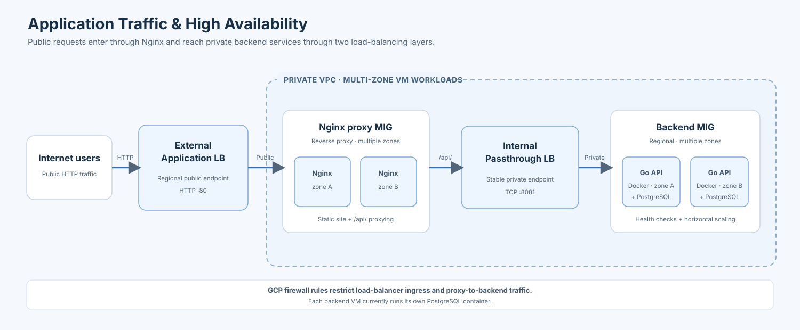
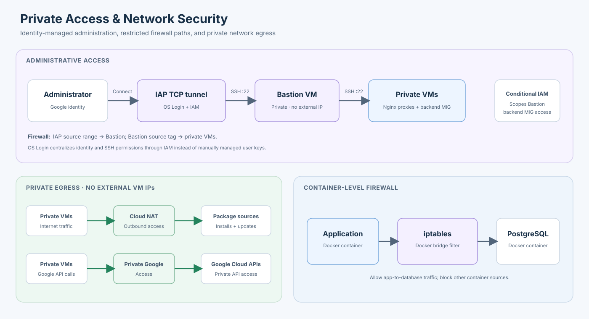
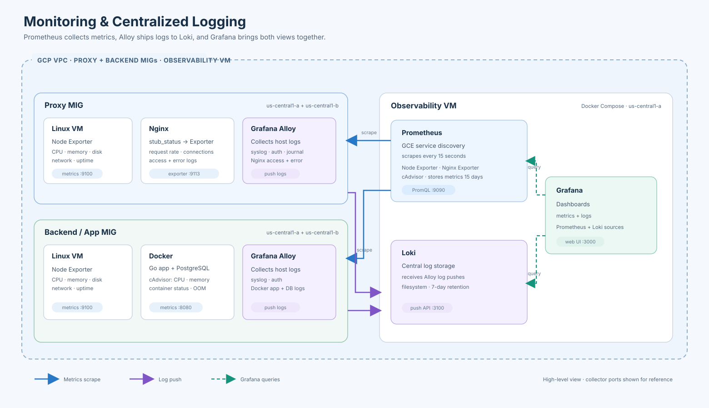

# GCP Nginx Infrastructure Architectures

## 1. Application traffic and high availability

## 2. Private access, firewall, and egress

## 3. Monitoring and centralized logging

## Start the cloud deployment

The MIG deployment is the closest match to these architectures. From the repository root:

    gcloud auth login
    gcloud config set project YOUR_PROJECT_ID
    bash run-all-resources-owner-account-with-mig-lb.sh

Update the script’s group and hard-coded checkout/image paths before running. The script provisions the backend MIG and internal load balancer, builds the application image, and creates a standalone proxy VM. The external load balancer and proxy MIG shown in diagram 1 require separate setup.
